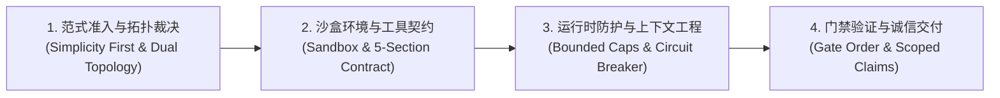

# Agent Engineering (AI Agent Harness 架构工程指南)

围绕任务结果设计、审查与排障 Agent 系统。大模型是非确定性的概率推断引擎，**系统可靠性的真正基石是 Harness（运行时挽具/外壳）**。一切关于执行安全、步数预算、沙盒隔离、死循环熔断、上下文保活与诚信验证的硬性指标，必须由 Harness 代码层兜底。

**核心第一性原理：同一规则只放在能执行或验证它的最小责任层，严禁跨层代偿**（不靠 Prompt 掩盖沙盒漏洞，不靠运行时重试弥补工具契约歧义）。

---

## 六大核心 References 索引 (Progressive Disclosure)

根据任务涉及的具体架构层级，查阅对应领域的指导原则与契约原型：

- 查阅执行循环生命周期、沙盒抽象、**工具死循环指纹熔断（Circuit Breaker）**、重连探针与事件总线原则，读取 [harness-loop-and-runtime.md](references/harness-loop-and-runtime.md)。
- 查阅 **5 段式描述契约（双重否定对抗 Bash 引力）**、指令化错误协议（Actionable Error）与工具工厂解耦原则，读取 [tool-contracts-and-design.md](references/tool-contracts-and-design.md)。
- 查阅**有界截断（预防优于清理）**、动态消息剪枝（`pruneMessages`）、**双轨制工作记忆保活防失忆**与 Prompt Caching 布局原则，读取 [context-and-memory-management.md](references/context-and-memory-management.md)。
- 查阅系统提示词分区分工（Role + Agency + Guardrails）、**行动优于解释（Act Don't Explain）**、Grep 先行探索、**模糊性仲裁协议（Search $\to$ Ask $\to$ Act）**与 `askUser` 原则，读取 [system-prompt-and-hitl.md](references/system-prompt-and-hitl.md)。
- 查阅**工作流优于自主代理准入准则（Simplicity First）**、单代理三大死因、**Explorer（廉价只读）与 Executor（高阶执行）二元拓扑**与结论提炼原则，读取 [subagent-delegation-patterns.md](references/subagent-delegation-patterns.md)。
- 查阅**毫秒级先错先停门禁顺序（`tsc` $\to$ `lint` $\to$ `test` $\to$ `build`）**、**Scoped Claims 诚信声明契约（严禁虚假全通）**与 Todo 单在办任务硬约束，读取 [verification-and-scoped-claims.md](references/verification-and-scoped-claims.md)。

---

## 核心决策流水线 (Four-Stage Harness Engineering Flow)

无论是**从零设计 (Design)**、**架构审查 (Review)** 还是 **排障归因 (Diagnose)**，严格按以下四个具有指导和引导意义的原则阶段执行：

### 步骤 1：范式准入与拓扑裁决 (Paradigm & Topology)

- **工作流优先原则（Workflows over Autonomous Agents）**：
  - 执行路径固定、步骤依赖明确时，必须使用确定性代码工作流（Prompt Chaining / Routing / Parallelization / Evaluator-Optimizer）；
  - 仅当修改范围完全开放、探索路径不可预测时，方可准入开放式 Agent Loop。
- **二元分工拓扑原则（Dual-Role Topology）**：
  - 局部小改动采用单 Agent 主控；
  - 跨文件复杂任务采用 **Explorer（只读/廉价模型/隔离沙盒）+ Executor（高阶模型/全工具/定向执行）**；主控只接收精炼结论，绝不吸纳探索过程的中间历史。

> **完成标准**：输出明确的架构范式选型依据；明确定义参与角色的权限边界与模型分级。

---

### 步骤 2：沙盒环境与工具契约 (Sandbox & Tool Contracts)

- **沙盒面向接口原则（Sandbox Abstraction First）**：
  - 工具代码严禁直接调用宿主 `child_process` 或操作物理磁盘；必须统一面向 `Sandbox` 抽象接口（`readFile`, `writeFile`, `exec`, `stop`）编程。
- **双重否定对抗万能工具引力原则（Fighting Bash Gravity via Doubled-Up Negatives）**：
  - 工具描述必须采用 5 段式契约（Summary, WHEN TO USE, WHEN NOT TO USE, DO NOT USE FOR, USAGE & EXAMPLES）；
  - 必须同时声明软重定向（WHEN NOT TO USE）与硬性禁令（DO NOT USE FOR），强力阻断模型向 `bash` 退化。
- **错误指令化原则（Instructions over Error Codes）**：
  - Tool Result 是下一轮模型的 Prompt；执行失败严禁返回纯状态码或空值，必须携带指向明确下一步行动的指导指令（Actionable Hint）。

> **完成标准**：工具工厂与沙盒实现解耦；所有工具均具备 5 段式描述与指令化错误格式。

---

### 步骤 3：运行时防护与上下文工程 (Runtime Circuit & Context)

- **预防优于清理原则（Prevention over Cleanup via Bounded Caps）**：
  - 工具输出必须在底层施加硬性截断（`read` 500 行、`grep` 50 条、`bash` 尾部 5000 字符保留报错现场），并在截断处携带分页提示；严禁依赖事后剪枝。
- **双轨制对抗剪枝失忆原则（Dual-Track: Ephemeral History vs. Durable State）**：
  - 对话历史在 `prepareCall` 中通过 `pruneMessages` 积极剥除旧工具调用对；
  - 核心架构事实与任务进度沉淀于 Todo 状态看板，在 System Prompt 中长效保活，彻底杜绝“剪枝后失忆进而重复读取”的恶性循环。
- **调用指纹与滑动熔断原则（Fingerprint Hashing & Circuit Breaker）**：
  - 维护最近工具调用的规范化指纹 `hash(tool_name, args)`；
  - 连续 2 次相同入参且报错/无增量，或在两个工具间震荡时，Harness 在底层短路拦截，主动注入 `[HARNESS CIRCUIT BREAKER]` 诊断警告。
- **执行层硬拦截原则（Execute-Level Gates over `needsApproval`）**：
  - 危险写操作的审批门禁必须在工具 `execute` 内部基于安全白名单强制阻断，绝不依赖模型自述的审批开关。

> **完成标准**：输出截断参数生效；死循环熔断器挂载；动态剪枝与工作记忆双轨保活就绪。

---

### 步骤 4：门禁验证与诚信交付 (Verification & Scoped Claims)

- **毫秒级先错先停原则（Millisecond-First Gate Sequence）**：
  - 验证命令必须按报错反馈速度递进执行：
    $$\text{typecheck (毫秒级暴露类型错误)} \longrightarrow \text{lint (静态合规)} \longrightarrow \text{test (逻辑回归)} \longrightarrow \text{build (全量构建)}$$
- **Scoped Claims 诚信声明原则（No Blanket Claims）**：
  - 报告必须严格拆分为两部分：“本次改动引发的新结果”与“项目中原有的存量既有失败”；
  - 严禁在存在任何失败或未运行测试时，以偏概全宣称“测试全部通过”。
- **模糊性仲裁三步走原则（Search first $\to$ Ask second $\to$ Act third）**：
  - 能搜到的自行检索；代码无约定且涉及关键架构取舍时，调用 `askUser` 提供 2~4 个结构化选项提问；严禁主观盲猜。
- **单在办任务硬约束（Single-Active-Item Constraint）**：
  - Todo 任务看板在任何时刻最多只能有 1 个任务处于 `in_progress`，杜绝注意力涣散与目标漂移。

> **完成标准**：验证通过并附带 Scoped Claims 诚信声明；Todo 看板各任务状态清零闭环；交付物可直接投入生产运行。
