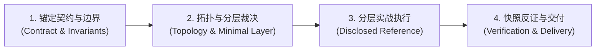

# Agent Engineering

围绕任务结果设计与审查 Agent。将 Model、Instructions、Context、Tools、Runtime、Environment 和 Evals 视为协作边界，**同一规则只放在能执行或验证它的最小责任层，严禁跨层代偿**（不靠 Prompt 掩盖 Runtime 漏洞，不靠 Runtime 弥补模型理解力缺口）。

---

## 五大专项 References 索引 (Progressive Disclosure)

根据任务涉及的具体责任层，按需读取对应领域的实战指南：

- 处理 Instructions、Prompt 黄金五段式结构与高频规则时，读取 [system-prompt-engineering.md](references/system-prompt-engineering.md)。
- 处理 Prompt Caching 物理三段布局、长程记忆三层漏斗或结构化压缩时，读取 [context-engineering.md](references/context-engineering.md)。
- 设计模型可见 Tool Surface、视觉上下文镜像与可执行错误契约时，读取 [tool-design.md](references/tool-design.md)。
- 涉及两阶段提议（Staged-Apply）、服务端签发 ID 白名单、并发写加锁、六维遥测关联与排障归因时，读取 [runtime-reliability.md](references/runtime-reliability.md)。
- 设计单轮状态快照评测（Snapshot Evals）、成对负例与分级 CI 缩圈流水线时，读取 [evals.md](references/evals.md)。

---

## 核心执行流程 (Four-Stage Execution Flow)

无论是**从零设计 (Design)**、**架构审查/排障 (Review & Diagnose)**，还是**性能演进 (Optimize)**，均严格按以下四步执行：

### 步骤 1：锚定契约与边界 (Task Contract & Invariants)

先明确会改变系统设计的业务与工程约束：
1. **目标与成功断言**：用户期望的最终交付物是什么？可由代码/数据独立验证的成功标准是什么？
2. **状态与副作用范围**：涉及哪些读取数据源？是否存在金钱、配置、外部发布等不可逆副作用？
3. **权限与审批红线**：哪些操作可自主执行？哪些必须由用户显式审批？哪些属于绝对禁止触碰的边界？
4. **资源与指标预算**：端到端延迟（TTFT/Total Latency）、Token 消耗与单任务成本上限。

> **完成标准**：输出清晰的**业务成功判定式 (Verified Success Criterion)** 与 **执行红线清单**；信息不足时，只澄清会改变技术架构与安全边界的实质歧义。

---

### 步骤 2：拓扑与分层裁决 (Topology & Minimal Responsible Layer)

#### 2.1 拓扑决策准则：动态技能优于多子代理 (Skills over Subagents)
- **三分之一法则（The 1/3 Rule）**：
  - 覆盖 $\ge 1/3$ 线上流量的通用能力直接固化在 System Prompt 中；长尾业务能力收敛为独立动态 Skills，由主 Agent 统一持有完整上下文运行；
  - 入口意图明确时，由 Harness 在首轮模型调用前预注入对应 Skill，消除加载轮次。
- **Subagent 唯二准入边界**：
  - **高噪音沙盒探索（如 Deep Research）**：需翻阅海量文件、跑代码回溯的任务，由 Subagent 自闭环并仅回传紧凑结论；
  - **独立合规域的彻底交接（Hand-off）**：如转接至具有强合规隔离的结算 Agent（必须是对白所有权的彻底转移，而非单轮内反复横跳）。

#### 2.2 最小责任层分工矩阵
将各项规则精确分配给唯一拥有它的最小层级，严禁错位：

| 层级 | 核心职责 | 绝对边界 (Prohibitions) |
| :--- | :--- | :--- |
| **Model** | 推理决策、语义对齐、上下文理解 | 严禁承担鉴权、数据一致性与不可逆操作保护 |
| **Instructions** | 稳定行为契约、优先级仲裁、输出格式 | 严禁堆砌长尾百科、易变事实与敏感凭据 |
| **Context** | 当前单轮决策所需的最小充分信息切片 | 严禁全量倾倒历史；严格执行前缀缓存友好布局 |
| **Tools** | 获取信息或发起动作的模型可见 Schema | 严禁返回内部宽表大字段；严禁返回无指引的哑巴错误 |
| **Runtime** | 状态机、两阶段提议、ID 白名单、并发加锁、六维遥测 | 严禁将模型自述当授权；遥测不作为业务恢复依赖 |
| **Environment** | 数据库、持久化存储、外部 API 真实源 | 业务真相的唯一所有者，不依赖上下文推测 |
| **Evals** | 单轮状态快照评测、成对负例、分级 CI、轨迹证据归因 | 默认评估最终 Outcome，不强求死锁中间执行路径 |

> **完成标准**：拓扑结构确定；每份状态、规则与限制均有且仅有唯一 Owner，不存在跨层代偿。

---

### 步骤 3：深入分层 Reference 执行 (Disclosed Reference Execution)

根据步骤 2 定位到的最小责任层，深入对应的专项 Reference，执行具体的工程实现或重构：
- 若涉及 **Prompt 编写**：采用黄金五段式结构，正向表达规则，核对 1/3 流量法则；
- 若涉及 **记忆与缓存**：严格按 Block 1 静态 / Block 2 半静态 / Block 3 动态分段，任务型 Agent 仅使用单会话 Working Memory 避免过度引入旁路 Worker；
- 若涉及 **工具契约**：前端组件设计为视觉镜像工具（对齐视觉树排布），提供具备 `actionable_hint` 的错误契约，轻量工具不滥用 Eager Streaming；
- 若涉及 **写操作、安全与排障**：全量落实两阶段提议（`stage_*` $\to$ `commit_*`），在 Runtime 增加服务端签发 ID 白名单校验、会话串行锁，并依照六维关联合约与偏离排障表进行根因定位；
- 若涉及 **质量评测**：采用单轮状态快照评测（Snapshot Evals），成对配置负例与越界用例，接入分级 CI。

> **完成标准**：产出具体、完整、可直接落地的 Schema、代码或配置，不出现未填补的伪代码空洞。

---

### 步骤 4：快照反证与结构化交付 (Snapshot Verification & Delivery)

1. **状态快照反证（Snapshot Falsification）**：
   - 使用包含多轮脏历史或矛盾前提的静态快照进行推演；
   - 验证成对负例：当关键参数缺失时，系统是否主动澄清？当遭遇非法 ID 或指令注入时，Runtime 是否坚决阻断？
2. **结构化交付输出**：
   - **架构与拓扑摘要**：单 Agent 技能划分与责任层落位；
   - **核心契约实现**：具体的 System Prompt、Tool JSON Schema、Runtime 拦截器代码；
   - **验证与反例清单**：成对负向快照用例与边界测试建议。

> **完成标准**：通过成对负向快照反证；无悬空假设；交付物自含且符合生产级工程标准。
