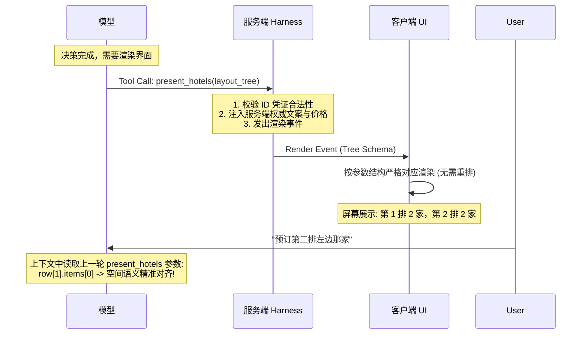

# Claude 生产级 Agent 架构实战模式 (Field-tested Patterns)

本文件沉淀源自 Anthropic 官方在大规模企业生产环境（涵盖零售、差旅、电信、票务与商户运营）中验证的 Agent 架构模式与参考实现。它不替代底层系统分层规范，而是为涉及**复杂交互、富 UI 呈现、交易安全、极低延迟与长程记忆**的 Agent 提供直接可落地的模式模板与反例警示。

---

## 目录

1. [拓扑模式：单 Agent 动态技能模式 (Skills over Subagents)](#1-拓扑模式单-agent-动态技能模式-skills-over-subagents)
2. [交互呈现：视觉-上下文镜像工具模式 (Visual Context Mirroring via Presentation Tools)](#2-交互呈现视觉-上下文镜像工具模式-visual-context-mirroring-via-presentation-tools)
3. [执行与安全：凭证白名单与两阶段提议模式 (Server-Issued ID Only & Staged-Apply)](#3-执行与安全凭证白名单与两阶段提议模式-server-issued-id-only--staged-apply)
4. [性能工程：总延迟方程与流水线调度 (Latency Breakdown & Eager Pipeline)](#4-性能工程总延迟方程与流水线调度-latency-breakdown--eager-pipeline)
5. [长程记忆：异步旁路抽取与三层漏斗 (Async Memory Pipeline & Three-Tier Retrieval)](#5-长程记忆异步旁路抽取与三层漏斗-async-memory-pipeline--three-tier-retrieval)
6. [质量保障：状态快照评测与敏捷 CI 缩圈 (Snapshot Evals & Targeted CI)](#6-质量保障状态快照评测与敏捷-ci-缩圈-snapshot-evals--targeted-ci)

---

## 1. 拓扑模式：单 Agent 动态技能模式 (Skills over Subagents)

### 痛点与反例 (Why Naive Approaches Fail)
面对覆盖多领域（搜索、导购、加购、退换货、商户分析）的复杂应用，工程团队极易直觉化地设计为“前置意图路由器 + 多个领域 Subagent（每个业务域一个）”。
* **状态损耗 (State-lossy Handoff)**：用户会话高度跨领域交织（如退货同时需比对新品）。跨 Subagent 移交时，必须序列化上下文；每次移交都造成严重的细节丢失，且增加数倍 Token 与数秒延迟。
* **边界重叠**：退换货流程既需要订单历史，又需要购物车和实时商品目录。多 Subagent 方案要么导致数据权限在各处冗余复制，要么在单个 Turn 中来回跳跃，体验快速劣化。

### 工业级方案 (Field-tested Practice)
采用 **“单一模型标准循环 + 动态技能加载（Single Agent with Skills）”**，会话始终由主 Agent 持有完整上下文。

```mermaid
flowchart TD
    User([用户 / 商户]) <--> Orchestrator[主 Agent Loop\n持有完整 Session 上下文与状态]
    
    subgraph SystemPrompt[System Prompt (>= 1/3 流量高频能力)]
        CoreRules[安全/合规/核心约束]
        CoreTool[核心高频工具: 如 search_products]
    end
    
    subgraph DynamicSkills[Skills: 按需/预加载长尾能力]
        S1[search-discovery]
        S2[customer-care]
        S3[pricing-promotions]
    end
    
    subgraph IsolatedSubagents[仅限自闭环子任务]
        DeepResearch[Deep Research Subagent\n(独立上下文折腾，仅回传摘要)]
    end

    Orchestrator --- SystemPrompt
    Orchestrator -. 按需加载 .-> DynamicSkills
    Orchestrator -- 工具调用 --> DeepResearch
```

### 决策准则
1. **三分之一法则（The 1/3 Rule）**：
   - 覆盖 $\\ge 1/3$ 线上流量的通用能力（如搜索、基础展示、结账语义），直接固定在 System Prompt 中，避免动态加载消耗额外模型轮次；
   - 剩余长尾能力划分为独立 Skills；如果用户入口信号明确（例如用户从退换货看板进入），**由 Harness 在第 1 次模型调用前主动预注入该 Skill**，消灭加载轮次。
2. **Subagent 唯二准入边界**：
   - **高噪音沙盒任务（如 Deep Research）**：需要频繁翻阅海量文件、跑代码、经历失败回溯的任务，用 Subagent 自闭环，仅向主会话返回紧凑结论；
   - **独立法律/合规平面的彻底交接（Hand-off）**：如转接至具有强隔离合规要求的金融结算 Agent。此时必须是对话所有权的彻底转移，而非单轮内反复跳跃的委托（Delegation）。

---

## 2. 交互呈现：视觉-上下文镜像工具模式 (Visual Context Mirroring via Presentation Tools)

### 痛点与反例 (Why Naive Approaches Fail)
* **自定义 Markdown/XML 标签解析**：让模型在文本中吐出 `<product-card id="123">` 由前端解析。模型对专有标签的指令遵循率显著低于原生 Tool Call，易出现格式崩溃；且破坏了聊天记录在原生 API 中的序列化回放。
* **扁平列表（Flat List）重排导致空间指代漂移**：工具仅返回平铺数组 `[{id:1}, {id:2}, ...]`，客户端自行用 CSS Grid/Carousel 布局。当用户下一轮说：*“选左边第三个”* 或 *“第二排第一个酒店”* 时，模型在自己的上下文历史里只看到无序列表，根本无法映射到屏幕上的物理位置，必然答非所问。

### 工业级方案 (Field-tested Practice)
**组件即工具（UI Components as Tools）**，且**展示工具的入参结构必须完全镜像客户端渲染的视觉树与排列次序**。



### 参考 Tool Contract 实现

```json
{
  "name": "present_hotels",
  "description": "向用户屏幕展示酒店推荐卡片。参数结构必须与前端呈现的行(rows)和轮播(carousels)视觉布局完全一致，以便在多轮对话中理解用户的空间指代（如'第二排第一个'）。",
  "eager_input_streaming": true,
  "parameters": {
    "type": "object",
    "properties": {
      "user_facing_summary": {
        "type": "string",
        "description": "向用户简要陈述推荐理由（如：已为您按临海和高性价比分组筛选）"
      },
      "sections": {
        "type": "array",
        "description": "按屏幕从上到下排列的展示区块",
        "items": {
          "type": "object",
          "properties": {
            "title": { "type": "string", "description": "区块标题，如：临海优质之选" },
            "display_mode": { "type": "string", "enum": ["carousel", "grid_row"] },
            "items": {
              "type": "array",
              "description": "按视觉从左到右严格排序的实体项",
              "items": {
                "type": "object",
                "properties": {
                  "hotel_id": { "type": "string", "description": "必须是本会话 search_hotels 下发的合法 ID" },
                  "highlight_tag": { "type": "string", "description": "推荐标签，如：近沙滩" }
                },
                "required": ["hotel_id"]
              }
            }
          },
          "required": ["title", "display_mode", "items"]
        }
      }
    },
    "required": ["user_facing_summary", "sections"]
  }
}
```

### 流式微操：`eager_input_streaming: true`
* **问题**：标准 Tool Call 在服务端默认等待完整顶层参数闭合后才验证转发，对于 500~700 Token 的复杂组件，导致用户面对 5 秒以上的空白等待。
* **落地**：在工具定义上开启 `eager_input_streaming: true`，服务端绕过整块缓冲，逐个参数流式推送到前端实现渐进渲染；在外层包裹一次重试机制以防御偶发 Schema 违规。

---

## 3. 执行与安全：凭证白名单与两阶段提议模式 (Server-Issued ID Only & Staged-Apply)

### 痛点与反例 (Why Naive Approaches Fail)
* **模型直接触发最终动作**：让模型调用 `place_order(cart_id)` 或 `update_price(sku, price)`。System Prompt 中的防范规则只需一次越狱或数据注入（如竞品恶意评价中暗含 Prompt）就会被绕过，导致资金和商业灾难。
* **幻觉 ID 与拼接 ID**：模型幻觉编造商品 ID，或者直接使用用户在聊天框粘贴的外部 ID，导致越权访问其他租户或损坏后端状态。

### 工业级方案 (Field-tested Practice)

```mermaid
stateDiagram-v2
    [*] --> ModelRead: 用户请求改价/加购
    ModelRead --> ServerWhitelist: 服务端查询返回合法实体
    Note over ServerWhitelist: Harness 记录本次 Session 签发的<br/>有效 ID 白名单集合
    ServerWhitelist --> ModelPropose: 模型发起修改
    
    state ModelPropose {
        direction LR
        ModelAction: 调用 stage_change(...)
        CheckWhitelist: 校验 ID 是否在会话白名单
        ModelAction --> CheckWhitelist
    }
    
    CheckWhitelist --> StagedRecord: 生成服务端 Staged ID\n(进入挂起状态，未生效)
    StagedRecord --> HumanApproval: 触发真实审批面\n(Portal按钮/CLI确认/双人复核)
    HumanApproval --> HarnessApply: apply_change(staged_id)
    Note over HarnessApply: 1. 复核最新业务策略与额度上限<br/>2. 真正写入业务底层
    HarnessApply --> [*]: 状态最终提交
```

### 决策准则
1. **模型只提议，策略/人类才应用（The Model Stages; a Person or Policy Applies）**：
   - 严禁向模型暴露直接产生扣款、退费、真实库存扣减或对外改价的 Tool；
   - 模型最大权限仅为生成 `staged_change`，必须通过独立审计通道（如用户点击前端按钮、操作员 Portal、Managed Agents 平台审批）由外部触发真正的 `apply`。
2. **服务端签发 ID 白名单凭证（Server-Issued IDs Only）**：
   - Harness 维护当前会话中服务端工具返回过的合法 ID 集合；
   - 所有的写入工具和展示工具**严禁接受未经本会话下发过的 ID**。无论该 ID 来自用户输入、评论爬虫、还是模型幻觉，在到达业务系统前直接拦截。
3. **受规管文案（Regulated Copy）服务端权威直填**：
   - 对于法定费率、违约条款、退改声明，模型只负责指定目标 ID，文案内容 100% 由服务端权威模版补齐，禁止模型复述或改写。
4. **限额校验基于“写入后状态”，并严格会话串行化**：
   - 购买限额或调价幅度不能只检查增量。必须针对“应用本次写入后的全局聚合结果”进行强校验；
   - 单会话写操作在服务端严格加锁串行化，防止单轮内的并发工具调用叠加突破风控阈值。

---

## 4. 性能工程：总延迟方程与流水线调度 (Latency Breakdown & Eager Pipeline)

### 核心延迟方程
$$\\text{Task Completion Latency} = \\sum_{\\text{turns}} (\\text{Time-To-Last-Token}_{\\text{model}} + \\text{Time}_{\\text{tool}})$$

优化目标始终是**整个任务的总耗时**，而非局部的单 Token 生成速度。

### 关键优化杠杆

| 杠杆 | 实践微操 | 决策收益 |
| :--- | :--- | :--- |
| **高智商模型降轮次** | 在复杂交易或长任务中，优先选用高推理模型（如 Claude Sonnet / Opus） | 聪明模型规划准、工具参数一次成功，往往 2 轮终结任务；轻量模型因理解偏差、补参反复试探，虽单字快但耗费 5 轮以上，总延迟反而大幅超标 |
| **前置上下文注入** | 宿主识别用户来源（如特定商品详情页、商户营销看板），在首轮调用前直接将页面数据注入 Context | 消灭模型在第 1 轮发起探测性 Tool Call 的整轮往返延迟 |
| **工具急进分发 (Eager Dispatching)** | 利用工具参数流式生成特性，当某独立工具参数闭合时立即异步请求后端 | 将数秒的等待空隙压缩至数百毫秒；**并在 Prompt 中指引模型优先输出耗时最长的慢工具调用** |
| **独立查询单轮并行** | 严禁多项查询串行发出；引导模型单轮输出 Tool Call 数组 | 避免多次往返 |
| **感知延迟管理** | 发送渐进流式卡片，并在后台长时探查时输出平实语言进度条（"Show the work"） | 维持交互动感，降低用户焦虑 |

### Prompt Caching 极致化（目标：90~99% 命中率）
请求结构必须按更新频次严格划分为三段：

```text
┌────────────────────────────────────────────────────────┐
│ [1] Global Segment (全局极稳定区)                       │
│ - 大部分 System Prompt                                 │
│ - 全量 Tools 定义                                      │
│                                                        │
│ >>> [CACHE BREAKPOINT 1: 全会话共享] <<<                │
├────────────────────────────────────────────────────────┤
│ [2] Session Segment (会话稳定区)                        │
│ - 用户固定偏好与身份事实                                │
│ - 累积历史消息与 Tool Results                           │
│ - 动态加载的 Skills (必须作为 Tool Result 存入此区)     │
│                                                        │
│ >>> [CACHE BREAKPOINT 2: 每轮推移到最新 User Turn 末尾] <<< │
├────────────────────────────────────────────────────────┤
│ [3] Volatile Segment (高频易变区)                      │
│ - 当前精确时间戳、当前访问页面、即时位置               │
│ (严禁放在 System Prompt 顶部，必须放在请求最末尾!)       │
└────────────────────────────────────────────────────────┘
```

---

## 5. 长程记忆：异步旁路抽取与三层漏斗 (Async Memory Pipeline & Three-Tier Retrieval)

### 痛点与反例 (Why Naive Approaches Fail)
* **主轮次调用 `save_memory` 工具**：每存一条记忆都需要模型发起一次额外工具调用，不仅侵占交互轮次、拖慢用户端响应，还与主决策争抢注意力，在 Anthropic 实测评测中导致 **13% 的关键记忆遗漏**。
* **提取器上下文污染**：若直接将会话中的 Tool Result（如商品规格、用户评价）送入记忆抽取，导致商品属性被误判为用户的个人属性（如误将商品尺码记为用户鞋码）。

### 工业级方案 (Field-tested Practice)

```mermaid
flowchart LR
    subgraph OnlineLoop[用户交互主路径 (极速响应)]
        User[用户] <--> MainAgent[主会话 Agent]
    end
    
    subgraph AsyncPipeline[旁路异步记忆流 (零延迟惩罚)]
        MainAgent -. 每轮结束后异步派发 .-> Extractor[轻量抽取 Agent\n(只读 User/Assistant 纯文本)]
        Extractor --> Validator[记忆白名单验证器]
        Validator --> DB[(结构化记忆库\n键值+类别+时效+人员)]
    end
    
    subgraph ReadFunnel[三层读取漏斗]
        DB --> L1[1. Always in context: 默认店铺/核心偏好]
        DB --> L2[2. Pre-fetched per turn: 随当前意图预拉取]
        DB --> L3[3. Lookup Tool: 长尾信息按需查询]
        L1 & L2 & L3 --> MainAgent
    end
```

### 记忆设计关键要点
1. **纯净文本提取**：旁路提取器**只输入 User 和 Assistant 的对白文本，严禁输入 Tool Results**，彻底杜绝数据噪音。
2. **操作人隔离（Keyed by Person, not Account）**：针对商户后台等多操作员共用主账号的场景，记忆必须绑定到自然人（Operator ID），严禁跨人越权召回。
3. **记忆数据治理**：
   - 写入路径设置强类型白名单校验器（拒绝合规敏感数据）；
   - 提供用户查询、编辑与一键删除面板（对齐 GDPR/隐私合规）；
   - 设定 TTL 过期保留期，避免几年前的过期喜好干扰当前判断。

---

## 6. 质量保障：状态快照评测与敏捷 CI 缩圈 (Snapshot Evals & Targeted CI)

### 痛点与反例 (Why Naive Approaches Fail)
* **双模型互聊模拟评测（Simulated-User Evals）**：用一个 LLM 扮用户、一个 LLM 扮 Agent 跑端到端多轮模拟。两个不确定性系统交互导致方差剧烈放大、成本极高、失败归因极其困难。
* **干净初始状态陷阱**：测试集全是从干净的第一轮（Turn 1）开始，无法发现真实线上在长上下文、充满工具失败重试、或者用户中途推翻前设时的脆弱表现。

### 工业级方案 (Field-tested Practice)

#### 1. 状态快照式评测 (Snapshot Evals)
利用 API 的无状态特性，直接构造真实世界中的特定状态快照：
- **前置构造（Preconditions）**：注入包含多次工具调用、冗余搜索结果或前后矛盾的历史上下文；
- **单轮运行（Run Single Turn）**：追加目标测试消息，仅执行当前一轮；
- **结果断言（Grade the Outcome）**：断言最终产生的新状态、渲染的 UI 组件类型、以及最后一次写入工具的入参，**不强行限制中间推理路径**。

#### 2. 成对负向用例覆盖 (Missing Negatives)
编写评测用例必须成对构建：
- 有 *“应该回答/加购”*，就必须有对应的 *“应该拒绝/越权拦截”*；
- 有 *“直接执行”*，就必须有对应的 *“信息不足应向用户主动澄清”*。

#### 3. 组织级 CI 缩圈分流 (Targeted CI Suite)
在大团队多人协作同一 Agent 时，避免每次 PR 全量回归，按依赖拓扑缩圈：

```text
每次 PR 提交:
  ├── 核心保护圈 (全量高频基线 + 所有安全合规注入用例)
  ├── 变动关联圈:
  │     ├── 若改动 Tool -> 跑调用该 Tool 的所有 Case
  │     ├── 若改动 Skill -> 跑该 Skill 自身的 Case + 与相邻 Skill 的边界 Case
  │     └── 若改动主 System Prompt -> 触发全量回归
  └── 质量门禁: 多次试验通过率 + Cache 命中率 + 单任务 Token 成本

每夜构建 / 封版发版:
  └── 运行 100% 全量生产快照回归集
```\n