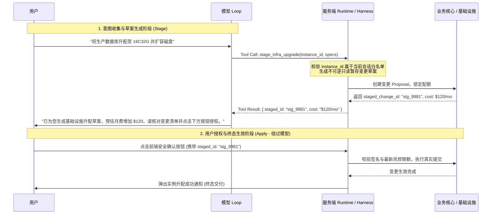

# Agent Runtime Reliability 实战指南

Runtime 负责模型无法可靠强制的执行语义、安全屏障与可观测运行边界：权限隔离、高危副作用控制、并发加锁、遥测关联合约、超时不确定性恢复与数据一致性。业务系统与 Environment 继续作为业务真相的唯一所有者。

---

## 1. 核心心智模型与经验法则 (Rules of Thumb)

- **两阶段提议法则（The Staged-Apply Pattern）**：
  - **模型对破坏性、高爆炸半径或涉及业务实体的写操作，只拥有“生成草案（Stage）”的权力，绝不赋予“直接提交生效（Commit）”的权力**。
  - 高危动作必须拆解为：模型调用 `stage_*` 生成暂存草案 ID $\to$ 用户/审计系统在独立 UI 界面点击核验 $\to$ 宿主系统发起最终生效。
- **凭据白名单法则（Server-Issued ID Only）**：
  - 写操作工具严格只接收当前会话中**由服务端在前置查询工具中合法签发的 ID 白名单**；
  - 严禁信任模型凭空捏造、或来自不可信外部文本中提取的任何资源 ID。
- **限额风控必须基于写后累加态（Enforce Limits on Resulting State）**：
  - **风控与限购检查必须作用于执行后的累加终态，绝不能只校验单次请求增量**！Agent 经常会重新表述或分步调用（如先加 2 个，再加 2 个），基于增量的检查会被轻松穿透。
- **合规与敏感文案服务端 100% 逐字供给（Approved Copy Injection）**：
  - 费用说明、违约金扣除、法律披露等强监管文本，**模型仅决定“触发披露的时机”，具体文案必须由服务端逐字注入**；严禁模型自由发挥或口语化转述。
- **会话写操作加锁串行化（Session Write Lock）**：
  - 会话内的所有资源写操作必须在 Runtime 层加锁串行化，彻底消除用户连击或模型多 Tool 并发调用引发的数据竞态。
- **危险操作的不确定性隔离（Indeterminate Isolation for High-Blast-Radius Actions）**：
  - 遇到网络超时或断连时，写操作本质处于“量子不确定态”；**严禁盲目原地重试写操作**，必须通过状态对账查询通道确认真实结果。
- **六维运行关联合约（The 6-Key Correlation Contract）**：
  - 任何一次 Agent 执行日志与 Span，必须携带 6 个单一职责的关联键，使运行事实可回溯，但**遥测绝不反向充当业务恢复状态**。

---

## 2. 常见反模式与失败根因 (Anti-Patterns)

### 反模式 1：赋予模型直接执行单阶段写操作 (Single-Stage Write)
* **错误做法**：提供 `execute_payment(order_id, amount)` 或 `delete_cluster(cluster_id)` 工具，模型一旦调用，后端直接触发真实销毁或划款。
* **失败根因**：
  - 一旦用户使用欺诈性 Prompt，或模型发生参数幻觉，不可逆的破坏瞬间发生；
  - 缺乏业务层与用户侧的双向确认凭据。

### 反模式 2：盲目信任模型传入的实体 ID (Trusting Model-Generated IDs)
* **错误做法**：模型调用 `apply_discount(user_id, coupon_id)` 时，后端不做会话校验直接执行 SQL。
* **失败根因**：
  - 用户可能在对话中诱导模型输入另一个租户或受害者的 `user_id`，造成严重的水平越权（IDOR）漏洞；
  - 模型可能幻觉出一个不存在但格式合法的 ID，破坏数据库外键约束。

### 反模式 3：仅校验单次请求增量导致限额被分步击穿 (Request-Delta Only Limit)
* **错误做法**：在加购工具中校验 `if (quantity > 3) throw Error("限购3件")`。
* **失败根因**：
  - Agent 在多轮对话或同轮多工具调用中，先执行 `add(quantity=2)`，再执行 `add(quantity=2)`；两次增量检查全部通过，用户成功加购 4 件，风控限额彻底形同虚设！
* **正确做法**：在写后数据库快照层校验：`if (current_cart_total + quantity > 3) reject`。

### 反模式 4：允许模型自由转述法律与合规文案 (Model-Paraphrased Disclosures)
* **错误做法**：在 Prompt 中要求“请向用户解释退订该票品需要扣除 20% 手续费且不可退还”。
* **失败根因**：
  - 模型在对话中常常省略“不可退还”或把“20%手续费”漏说为“免收手续费”，造成不可逆的客诉与法律纠纷。

---

## 3. 工业级标准实现与模板 (Production Patterns)

### 3.1 两阶段提议模式（Staged-Apply）时序规范



### 3.2 服务端签发 ID 拦截校验逻辑 (Pseudo-code)

```python
class RuntimeSafetyHarness:
    def __init__(self, session_id: str):
        self.session_id = session_id
        # 记录本会话内由前置只读查询工具返回过的合法 ID 集合
        self.session_valid_ids = set()

    def on_tool_result(self, tool_name: str, result: dict):
        """当只读工具返回结果时，将合法 ID 存入会话白名单"""
        if tool_name in ["search_instances", "get_cart", "list_records"]:
            for item in result.get("items", []):
                self.session_valid_ids.add(item["id"])

    def intercept_write_tool(self, tool_name: str, arguments: dict):
        """在写操作发起前进行强拦截"""
        target_id = arguments.get("target_id")
        if target_id not in self.session_valid_ids:
            raise SecurityViolationError(
                f"拒绝执行: 传入的 ID [{target_id}] 未在当前会话的合法签发白名单中。"
            )
        # 校验通过，放行执行草案生成
```

### 3.3 可观测运行：六维关联合约定义表 (The 6-Key Contract)

每个由 Runtime 发出的 Span 与 Log 事件中必须包含以下标准关联键：

| 关联键 | 作用范围 | 业务含义 | 典型示例 |
| :--- | :--- | :--- | :--- |
| `session_id` | 多轮连续性 | 贯穿整个用户长会话的生命周期 | `"ses_10928374"` |
| `run_id` | 单次交互 Loop | 一次用户提问到最终回复之间的完整循环 | `"run_98234"` |
| `trace_id` | 分布式全链路 | 跨微服务调用的 OpenTelemetry 链路 ID | `"4bf92f3577b34da6a3ce929d0e0e4736"` |
| `span_id` | 局部动作 | 单个 Model Turn 或单个 Tool Call 的独立执行区间 | `"00f067aa0ba902b7"` |
| `attempt_id` | 重试与重入 | 区分当前是该动作的初次执行还是第 N 次重试 | `1`, `2` |
| `operation_id` | 业务意图去重 | 关联非幂等操作的唯一业务单号/幂等键 | `"op_order_refund_449"` |

### 3.4 典型偏离排障归因表 (Discrepancy Attribution Playbook)

当排查线上 Badcase 时，依据下表快速定位最早发生偏离的层级：

| 监控症状 | 常见根因定位 | 判定与修复动作 |
| :--- | :--- | :--- |
| **Tool 死循环** | 错误返回缺乏指引；或模型未获得终止条件 | 查看 Tool Result 是否为哑巴错误；在 Tool Contract 中增加 `instruction` 指引。 |
| **上下文遗忘** | Compaction 压缩过度；关键 ID 未持久化 | 检查 Working Memory 模板；将丢失字段固化进持久化前缀。 |
| **越权拦截报警** | 误信模型 Prompt；依赖权限过滤而非服务端拦截 | 检查 Runtime 拦截器；将白名单校验下沉至服务端强制拦截层。 |
| **伪成功 (False Success)** | 仅依据 Tool 返回 200 即判定成功，未核验业务实质 | 在 Act 之后增加 Verify 步骤，主动回读业务源数据库确认变更生效。 |

---

## 4. 核心工程机制：高危副作用的不确定性终态与对账回路 (Indeterminate State & Reconciliation)

> [!IMPORTANT]
> **危险操作的不确定性隔离（Indeterminate Isolation）**
> - **为什么重要**：在分布式网络与外部系统中，任何涉及资产转移、物理资源销毁、基础设施配置修改或对外发布等不可逆动作，**网络超时或连接中断（504/Connection Reset）并不代表动作未在底层发生**。调用方没拿到回包，可能只是响应在网络途中丢包。
> - **抽象机制**：
>   1. **量子不确定态（Indeterminate State）**：非幂等写操作一旦遇到未决响应，系统严禁当场判定为失败并原样重试；状态机必须立即将该操作转入 `indeterminate` 状态；
>   2. **主动对账回路（Reconciliation Loop）**：Runtime 暂停当前推进链路，以 `operation_id` / 业务单号为依据，调用专用的状态查询（Get / Status Inquiry）接口进行对账：
>      - 若对账发现底层已执行成功 $\to$ 收敛为已完成，继续向下流转；
>      - 若对账明确未执行且条件仍满足 $\to$ 安全放行单次受控重试；
>      - 若对账仍无法断定 $\to$ 挂起并触发告警，提示人工接管核验。
> - **梯度裁剪**：高危不可逆操作必须强制走对账回路；普通具备数据库天然幂等性或唯一约束的只读/轻量写操作，直接采用带退避因子的重试机制即可。

---

## 5. 落地核验清单 (Checklist)

- [ ] **两阶段提议**：高危写操作（涉及资金、权限、数据删除、对外发布）是否全量拆分为 Stage 与 Apply 两阶段？
- [ ] **白名单拦截**：写工具入参中的 ID 是否经由 Runtime 拦截层校验，确保 100% 来源于前置查询？
- [ ] **累加态风控**：风控限购、预算限额是否基于写后累加态（Resulting State）做判定？是否结合了单会话串行写锁？
- [ ] **合规原文注入**：法务条款、手续费说明是否由服务端 100% 逐字供给，未让模型口语化自行总结？
- [ ] **不确定隔离**：不可逆高危写操作遭遇超时或 5xx 时，是否强制转入 `indeterminate` 走状态对账回路，而非原地重复提交？
- [ ] **六键关联**：Runtime 发出的所有调用 Span 是否已完整绑定六维关联键？
