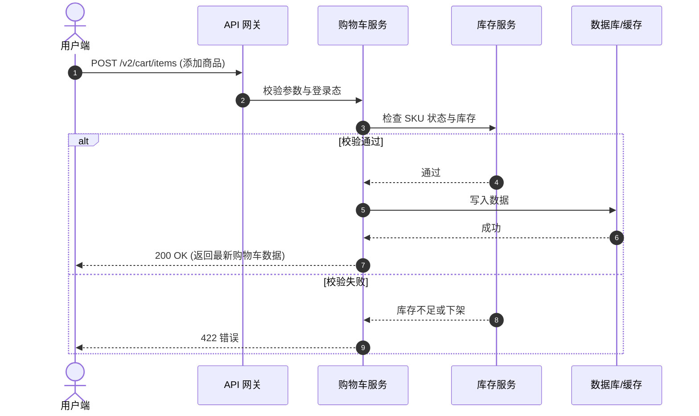
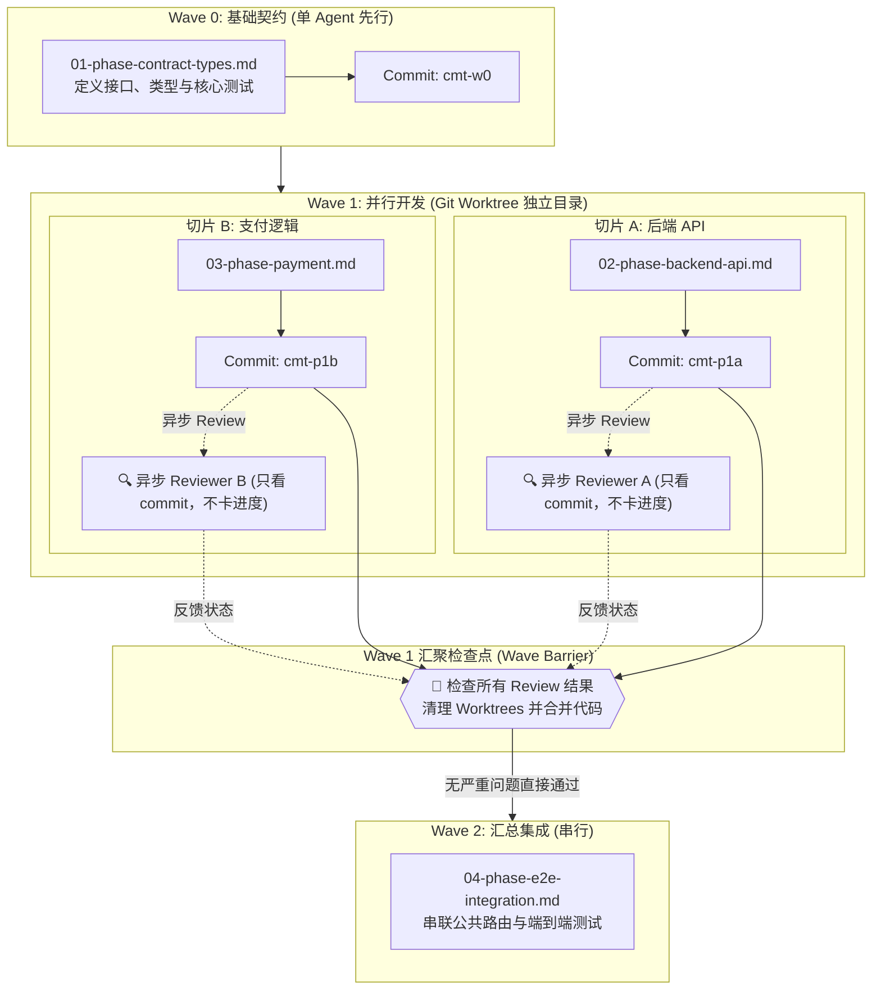

# Task Breakdown Document Templates

本文件为 `docs/tasks/{taskfolder}/**` 任务包提供标准 Markdown 模板与字段说明。

---

## 1. 任务总览模板 (`00-overview.md`)

```markdown
# 任务总览：{Task Name}

> 任务路径：`docs/tasks/{taskfolder}/`  
> 启动日期：YYYY-MM-DD  
> 当前状态：`Planning` | `In Progress` | `Completed`  
> 需求或契约来源：[PRD / RFC / 接口文档链接](#)  
> 变更记录：[`changes.md`](changes.md)  
> 历史包袱记录：[`legacy-burdens.md`](legacy-burdens.md)  
> 未决问题清单：[`issues.md`](issues.md)

---

## 1. 业务背景与目标 (Context & Goal)

### 1.1 现状与痛点
- **老系统怎么实现的**：简述现有逻辑和当前痛点。
- **为什么现在要做**：本次改造的触发原因。

### 1.2 预期交付目标
- 改造完成后的期望形态与可观察结果。

### 1.3 范围 (Scope)
- **本次要做的 (In-Scope)**：
  - [x] 功能点 1
  - [x] 功能点 2
- **明确不做的 (Non-Goals)**：
  - 本次不做、延后考虑的需求。

---

## 2. 核心业务实体与系统规则 (Entities & Invariants)

> **开发准则**：所有子任务开发必须严格遵守以下业务规则，严禁私自修改破坏。

### 2.1 核心实体 (Core Entities)
- **`Cart` (购物车)**：用户维度的购物车对象，包含多个 CartItem。
- **`CartItem` (条目)**：具体商品条目，包含 Sku、数量、单价快照等。

### 2.2 绝对不能破坏的系统规则 (Invariants)
1. **[INV-01] 幂等防重**：同一用户短时间内重复添加同一 SKU，必须合并数量，严禁生成两条重复数据；
2. **[INV-02] 金额计算规则**：`最终支付金额 = 商品总价 - 优惠金额`，计算结果向下取整到分，不能出现负数；
3. **[INV-03] 状态单向流转**：条目状态只能由 `ACTIVE` 流转到 `ORDERED`，不能逆向回滚。

---

## 3. 核心流程时序图 (Sequence Flow)



---

## 4. 统一术语表 (Glossary)

> 所有代码变量名、数据库字段、接口命名中必须统一使用以下词汇，严禁混用近义词：

| 标准术语 | 禁止使用的混淆词 | 说明与格式 |
| :--- | :--- | :--- |
| **`cart_id`** | `basket_id`, `order_cart_id` | 购物车唯一 ID（UUID 字符串） |
| **`sku_id`** | `item_id`, `product_id` | 具体商品规格编码（字符串） |
| **`unit_price`** | `price`, `cost` | 单价，以“分”为单位的正整数（integer） |

---

## 5. 关键架构选型记录 (ADRs)

- **[ADR-01] 为什么用 Redis Hash 存购物车而不是查 MySQL**：
  - **原因**：大促高并发下读 MySQL 容易打爆数据库。
  - **折衷**：采用 Redis 存储，7 天滑动过期，DB 异步备份。接受极小概率下的秒级延迟。

---

## 6. 分批执行拓扑图 (Execution Waves)



---

## 7. 任务执行看板与配额限制 (Execution Kanban)

| 阶段文件 | 批次 | Worktree 目录 | 推荐模型 | 轮次上限 | 单测重试上限 | 快照 Commit | Review 状态 | 状态 |
| :--- | :--- | :--- | :--- | :--- | :--- | :--- | :--- | :--- |
| [`01-phase-contract-types.md`](01-phase-contract-types.md) | Wave 0 | *(主目录)* | `flash` | ≤ 8 轮 | ≤ 2 次 | `a1b2c3d` | `PASSED` | `Done` |
| [`02-phase-backend-api.md`](02-phase-backend-api.md) | Wave 1 | `.worktrees/phase-02-api` | `flash` | ≤ 12 轮 | ≤ 2 次 | `e4f5g6h` | `PASSED` | `Done` |
| [`03-phase-payment.md`](03-phase-payment.md) | Wave 1 | `.worktrees/phase-03-pay` | `pro` | ≤ 15 轮 | ≤ 2 次 | `i7j8k9l` | `IN_REVIEW` | `In Progress`|
| [`04-phase-e2e-integration.md`](04-phase-e2e-integration.md) | Wave 2 | *(主目录)* | `pro` | ≤ 15 轮 | ≤ 2 次 | 待定 | 等待屏障 | `Todo` |

---

## 8. 当前执行断点 (Pipeline Checkpoint)

- **当前批次**: `Wave 1`
- **活跃的 Worktree 分支**:
  - `.worktrees/phase-02-api` (Commit `e4f5g6h`, Review: `Passed`)
  - `.worktrees/phase-03-pay` (状态: `In Progress - 正在执行步骤 2，当前轮次 7/15`)
- **下一步恢复操作**:
  - 进入 `.worktrees/phase-03-pay` 继续写实现，若单测还不过则触发停机排查。

---

## 9. 完成验收标准 (Definition of Done)

- [ ] 所有子任务通过单测并提交原子 Commit；
- [ ] 核心业务规则（Invariants）经审查全部通过，无弱化断言或跳过测试；
- [ ] 所有临时 Worktree 已清理；
- [ ] [`issues.md`](issues.md) 中没有遗留阻塞问题；
- [ ] [`legacy-burdens.md`](legacy-burdens.md) 中的老代码包袱都有明确的处理记录；
- [ ] [`changes.md`](changes.md) 记录完备，各分支已完成 rebase 对齐。
```

---

## 2. 分阶段子任务模板 (`0X-phase-{slug}.md`)

```markdown
# Phase {X}: {阶段简述}

> 所属任务：[`00-overview.md`](00-overview.md)  
> 必须遵守：[`00-overview.md#2-核心业务实体与系统规则`](00-overview.md) 与 [`00-overview.md#4-统一术语表`](00-overview.md)  
> 执行批次：`Wave 0` | `Wave 1` | `Wave 2`  
> 开发目录：`Git Worktree (.worktrees/phase-{X})`  
> 当前状态：`Todo` | `In Progress` | `Done` | `Blocked`  

---

## 1. 🤖 子 Agent 派发提示词 (Dispatch Payload)

```yaml
role: "Phase-{X} Executor"
model: "flash"
workspace: "share"
cwd: ".worktrees/phase-{X}-{slug}"
limits:
  max_turns: 12        # 最多运行 12 轮工具调用，超限需自省退出
  max_test_retries: 2  # 测试失败最多重试修 2 次，第 3 次直接停止并挂单
  timeout_seconds: 300
prompt: >
  执行 docs/tasks/{taskfolder}/0X-phase-{slug}.md：
  1. 研读上下文：细读本文件的“2. 任务上下文 (Task Context)”，严格对齐上游输入、下游交付物与参考代码风格；
  2. 保护边界：
     - 只能修改 Exclusive Write Scope 声明的文件；
     - 严禁修改 package.json（Wave 1 依赖已锁定）；
     - 严禁修改只读的测试用例断言，严禁加 .skip 跳过测试；
  3. 遇到老代码问题：先看能不能顺手重构或包一层防腐接口，不要乱写 hack；如果实在必须写 workaround，记到底部的 Staged Legacy Burdens；
  4. 单测修了 2 次还不过，直接停下退出，标记为 Blocked，不要死循环乱改；
  5. 跑通单测后提交原子 commit：feat({scope}): {desc} [Phase-{X}]；
  6. 回传简短结论（改动文件、单测结果、commit hash），不超过 15 行。
```

---

## 2. 🧭 任务上下文 (Task Context)

### 2.1 业务场景与意图 (Scenario & Intent)
- **业务场景**：用户在购物车详情页点击“修改商品规格/颜色”时，前端向后端发起全量参数校验与价格刷新请求。
- **本切片核心价值**：打通规格变更后的金额重新计算逻辑，确保价格不出现负数或精度漂移。

### 2.2 上游输入与前置契约 (Inputs & Upstream Contract)
- **调用入口**：由 API Gateway 路由分发进入 `CartController.updateItemSpec`；
- **前置依赖类型**：依赖 Phase 1 已落地的 `UpdateCartItemDto`（见 `src/types/cart.ts#L30-45`）；
- **数据输入示例**：
  ```json
  {
    "cart_id": "c-10086",
    "sku_id": "sku-red-xl",
    "quantity": 2
  }
  ```

### 2.3 下游交付与消费方 (Outputs & Downstream Handoff)
- **交付产物**：导出 `CartService.updateSpec` 核心方法与对应的 HTTP Handler；
- **下游消费方**：供前端购物车组件联调，并作为 Wave 2 全链路结算的前提数据源。

### 2.4 参考实现与工程先例 (Reference Code Paths)
- **分层与事务写法参考**：`src/features/order/order.service.ts#L45-80`（参考其参数校验与错误映射范式）；
- **单测 Mock 规范参考**：`tests/unit/order-service.test.ts`（参考其内存隔离与断言结构）。

### 2.5 假设与限制 (Assumptions & Constraints)
- 假设 SKU 的库存校验在网关层已完成初步限流；
- 本切片严禁直连外部第三方支付接口。

---

## 3. 🔍 务实批判的 Reviewer 提示词 (Reviewer Payload)

> **客观守门员视角**：既不走过场点赞，也不吹毛求疵阻碍交付。守住 4 类硬红线，普通建议挂单放行：

```yaml
role: "Phase-{X} Critical Reviewer"
model: "pro"
tools: ["view_file", "run_command"]
prompt: >
  审查 docs/tasks/{taskfolder}/0X-phase-{slug}.md 对应的 Commit: <SNAPSHOT_COMMIT_HASH>：
  1. 查作弊 (硬红线)：检查测试 diff，严禁偷改已有断言、加 .skip、用空 catch 吞异常或写死假数据。发现作弊一票否决 (BLOCKER)；
  2. 查规则 (硬红线)：代码是否破坏了 00-overview.md 中的业务规则 (Invariants)；
  3. 查可达缺陷 (硬红线)：只针对真实可达的严重 bug 阻断，不为虚无缥缈的假想风险卡流程；
  4. 查妥协：核实暂存的老代码包袱，是否被 Agent 当作偷懒写垃圾代码的借口；
  5. 普通建议：代码坏味道或小优化，列入 SUGGESTIONS（记入 issues.md），给 PASS 放行；
  输出：PASS / PASS_WITH_SUGGESTIONS / BLOCKER。
```

---

## 4. 文件读写范围 (Scope Boundary)

- **允许修改的文件 (Exclusive Write Scope)**：
  - `src/features/cart/api/**`
  - `tests/unit/cart-api.test.ts`
- **只读文件 (Read-Only Scope)**：
  - `tests/e2e/cart-contract.spec.ts` *(核心验收测试，严禁修改断言)*
  - `src/types/cart.ts`
  - `00-overview.md`
- **禁止修改的公共文件 (Forbidden)**：
  - `src/index.ts` / `src/app-routes.ts` *(Wave 2 统一合并，本阶段别碰)*
  - `package.json` *(依赖已锁定，本阶段禁止改动)*

---

## 5. 执行步骤与单测验证

- [ ] **步骤 1：编写实现逻辑**
- [ ] **步骤 2：编写单测并覆盖 INV-01 与 INV-02**

```bash
# 验证命令（退出码必须为 0）
pnpm tsc --noEmit
pnpm vitest run tests/unit/cart-api.test.ts
```

---

## 6. 过程中新发现的问题与包袱暂存区

### 过程中发现的新问题 (Staged Issues)
- *(示例) 外部服务在压测下偶发超时*

### 过程中遇到的老代码包袱 (Staged Legacy Burdens)
- **目标**：计算总价
- **遇到的老代码**：`src/legacy/pricing.js` 全局变量存汇率，没有类型
- **原本想怎么妥协**：想直接在新代码里读这个全局变量
- **实际处理建议**：包一层适配接口隔离，不让新代码被带偏
```

---

## 3. 未决问题清单模板 (`issues.md`)

```markdown
# 未决问题与阻塞清单 (Issues & Blockers)

> 所属任务：[`00-overview.md`](00-overview.md)  
> 说明：记录需求没讲清的边界问题、外部依赖故障或 Review 提出的发现。

## 1. 问题汇总看板

| 编号 | 类别 | 问题简述 | 关联 Commit | 严重程度 | 状态 | 处理人 |
| :--- | :--- | :--- | :--- | :--- | :--- | :--- |
| **ISSUE-01** | 需求不明确 | 并发退款时没有防重保护 | Commit `a1b2c3d` | `Blocker` | `Resolved` | @张三 |
| **ISSUE-02** | 严重缺陷 | 未处理单价为 0 时的除零边界异常 | Commit `e4f5g6h` | `Blocker` | `Open` | @Reviewer |
```

---

## 4. 历史包袱记录与处理方式 (`legacy-burdens.md`)

```markdown
# 历史包袱记录与处理方式 (Legacy Burdens Log)

> 所属任务：[`00-overview.md`](00-overview.md)  
> 说明：**需求只管新目标，不会预知老代码有什么坑。本文件记录 Agent 在写代码时撞见的老代码坏味道，以及处理决策：是顺手清理了、加了防腐层，还是确实没办法只能先写临时 workaround。**

## 1. 历史包袱处理看板

| 编号 | 涉及模块 | 目标功能 | 遇到的老代码问题 | 最终处理方式 | 后续改进计划 |
| :--- | :--- | :--- | :--- | :--- | :--- |
| **BURDEN-00** | `src/utils/calc.ts` | 计算折扣金额 | 遗留 helper 使用 any 且无边界保护 | `顺手重构 (Boy Scout)` | 顺手补全强类型定义与单测，零额外技术债 |
| **BURDEN-01** | `src/legacy/order_mapper.py` | 订单详情接口 | 历史表混用了 item_id 和 items_id | `临时妥协 (Workaround)` | 改老表成本太高，下季度专项迁移数据库 |
| **BURDEN-02** | `src/shared/currency.ts` | 汇率换算 | 老逻辑把汇率挂在全局不可变对象上 | `加防腐层 (Anti-Corruption)` | 封装 CurrencyAdapter，新代码不直接读全局变量 |
```

---

## 5. 需求与方案变更记录 (`changes.md`)

```markdown
# 需求与方案变更记录 (Change Log)

> 所属任务：[`00-overview.md`](00-overview.md)  
> 规则：**只追加记录，不直接改旧文档！** 中途发生需求修改、接口变动或方案调整时，记录在此，避免日后查无凭据。

## 1. 变更清单

| 编号 | 日期 | 来源阶段 | 变更类型 | 变更简述 | 影响的 Worktree 分支 | rebase 同步状态 | 确认人 |
| :--- | :--- | :--- | :--- | :--- | :--- | :--- | :--- |
| **CHG-01** | 2026-09-19 | Phase 2 | 接口/字段变动 | CartItem 增加规格快照 spec_snapshot | `phase-02`, `phase-03` | `已完成` | @张三 |
| **CHG-02** | 2026-09-20 | Phase 3 | 技术方案调整 | 支付防重由单机内存改用 Redis 分布式锁 | `phase-03-pay` | `已完成` | @李四 |
```
