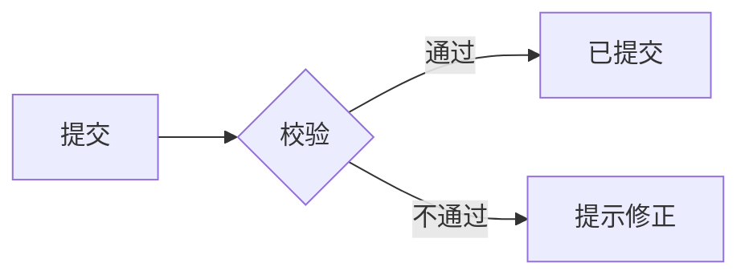

# PRD Sections

两部分各按自己的读者任务推进，不为凑完整感保留无对应决定或任务的小节。

## 决策部分（人看）

按“要决定什么 → 问题 → 旅程 → 目标 → 边界 → 方案 → 待拍板”推进。

| Section | 必须回答 | 常见失败 |
| --- | --- | --- |
| 决策摘要 | 要批准什么；问题与方案各一句；最大风险；待谁在何时拍板 | 写成背景铺垫，读完不知道要决定什么 |
| 背景与问题 / 证据 | 哪类用户在什么情境下遇到什么问题，证据是什么 | 用功能或内部偏好冒充用户问题 |
| 用户旅程 | 用户为何在此刻产生这个需求：触发与动机、当前如何凑合、端到端接触点与关键摩擦、期望结果 | 写成功能流程图；只写用上产品之后，丢掉需求产生的原因和现有替代做法 |
| 目标与成功指标（G） | 哪个可观察结果变化，指标口径、来源、时间窗；数据是否可取得、由谁在何时复盘；取不到时列明获取方式与依赖，结论保持待验证；护栏指标：哪个既有结果不允许变差，越线时停止或收敛范围 | 目标写成“提升体验”，把功能验收通过当作效果达成 |
| 范围与非目标（NG） | 这次做什么、明确不做什么及原因；涉及取舍或分期时，优先级、交付批次及依据，哪些需求必须一起交付 | 缺非目标；资源不足时无法判断先交付什么 |
| 方案概览 | 用户可见的方案形态与主流程图，按 R 引用规则 | 复述执行契约的规则，造成两处真相 |
| 业界实践（按需） | 行业里谁在什么约束下怎么做、来源与时间、可迁移什么、关键差异 | 把竞品功能直接当需求 |
| 依赖与开放问题（Q） | 依赖方、阻塞项、owner、下一步；每个 Q 的影响 R、是否阻塞、默认值、确认人与时点 | 开放问题藏进脚注；非阻塞问题没有默认值，agent 只能猜 |

## 执行契约（Agent 看）

按“词表 → 现状 → 需求 → 流转 → 异常 → 约束 → 切换 → 权限 → 参考”推进。

| Section | 必须回答 | 常见失败 |
| --- | --- | --- |
| 术语表 | 每个对象、状态、事件的正名、含义、对应 UI 文案；别名映射到正名 | 同一对象多个叫法，agent 当成不同实体 |
| 现状基线与不变量（INV） | 改动前的行为；本次必须保持不变的相邻行为及回归核对方式 | 只写新行为，agent 顺手改坏相邻功能 |
| 行为需求与验收（R / AC） | 条目格式见主文档：EARS 规则 + 强度 + 失败与边界 + 带核对方式的 AC + 依据 | 需求暗藏实现，验收用形容词，AC 不说由谁核对 |
| 状态与流程 | 状态机、时序依赖的 Mermaid 图；节点名取自术语表 | 状态只散落在各条 R 里，迁移规则无处可查 |
| 异常与边界 | 跨需求的失败、空、权限、并发、恢复后的最终状态 | 只写正常路径 |
| 质量约束 | 只在真实风险或标准要求时纳入，且给可验证门槛 | 机械填安全 / 性能模板 |
| 兼容与切换 | 存量数据、旧版本入口与既有行为的用户在切换期看到什么；切换失败或回滚后落到哪个最终状态（节奏与开关实现归技术方案） | 只写新用户的新行为，旧数据与旧版本行为未定义 |
| 决策权限 | 自主决定、按默认执行并报告、停下上报三类各自的边界 | 未写，agent 在未覆盖处自行发明行为 |
| 参考 | 设计稿、原型、组件库、接口文档、相关代码位置的链接及与 R 的对应 | 复述链接内容，副本过期后与源冲突 |

## 骨架

按上表决定展开，不原样保留全部小节。

````markdown
# PRD：一句话主题

> 权威源：`docs/prd/<主题>.md` · 版本 v1 · 副本：<链接或无>

## 第一部分 决策（人看）

### 决策摘要

### 背景与问题

### 用户旅程

### 目标与成功指标

- G-1 ……

### 范围与非目标

- NG-1 ……（原因）

### 方案概览



### 依赖与开放问题

| ID | 问题 | 影响 | 阻塞 | 默认值 | 确认人 / 时点 |
| --- | --- | --- | --- | --- | --- |

## 第二部分 执行契约（Agent 看）

### 术语表

| 正名 | 含义 | UI 文案 | 别名 |
| --- | --- | --- | --- |

### 现状基线与不变量

- INV-1 ……。核对：……

### 行为需求与验收

### 决策权限

### 参考

## 变更记录

- **[日期] / v1 / [全部实际需求 ID] / 新增**：[首版需求摘要]。原因：[依据]。影响面：[实际影响或待确认]。需重验的 AC：全部。提出人：[依据或待确认]。状态：[依据或待确认]。
````
